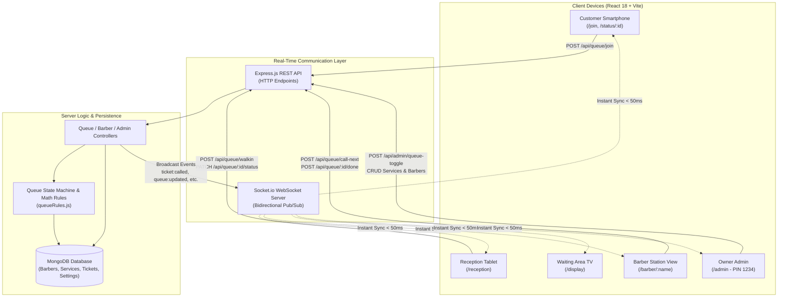

# Salon Queue Management System

**Live demo:** https://salon-queue-management-system-nu.vercel.app/  
**Hosted on:** Vercel (frontend) + Render (backend)  
**Staff / Admin PIN:** `1234`  
**Staff & Station Portals:**

- **Receptionist Dashboard:** [`/reception`](https://salon-queue-management-system.vercel.app/reception)
- **Barber Station Views:** [`/barber/Ravi`](https://salon-queue-management-system.vercel.app/barber/Ravi) • [`/barber/Amit`](https://salon-queue-management-system.vercel.app/barber/Amit) • [`/barber/Imran`](https://salon-queue-management-system.vercel.app/barber/Imran)
- **Waiting Area TV Display:** [`/display`](https://salon-queue-management-system.vercel.app/display)
- **Owner Admin Panel:** [`/admin`](https://salon-queue-management-system.vercel.app/admin) _(Protected by PIN: `1234`)_

<p align="center">
  
</p>

<p align="center">
  <a href="#-technology-stack"></a>
  <a href="#-technology-stack"></a>
  <a href="#-technology-stack"></a>
  <a href="#-technology-stack"></a>
  <a href="#-technology-stack"></a>
  <a href="#-technology-stack"></a>
  <a href="#-technology-stack"></a>
  <a href="#-dual-language-localization-en--gu"></a>
  <a href="#-automated-verification--testing-suite"></a>
  <a href="#-strict-constraints--dont-build-compliance"></a>
</p>

---

## 📖 Table of Contents

- [About The Project](#-about-the-project)
- [The Problem vs. The Salon Queue Solution](#-the-problem-vs-the-salon-queue-solution)
- [Core Features (The 7 Screens)](#-core-features-the-7-screens)
  - [1. Screen 1: Home Landing Page (`/`)](#1-screen-1-home-landing-page-)
  - [2. Screen 2: Join Queue (`/join`)](#2-screen-2-join-queue-join)
  - [3. Screen 3: My Status & Live Tracking (`/status/:id`)](#3-screen-3-my-status--live-tracking-statusid)
  - [4. Screen 4: Receptionist Command Dashboard (`/reception`)](#4-screen-4-receptionist-command-dashboard-reception)
  - [5. Screen 5: Barber Station View (`/barber/:name`)](#5-screen-5-barber-station-view-barbername)
  - [6. Screen 6: Waiting Area TV / 10-Foot Public Display (`/display`)](#6-screen-6-waiting-area-tv--10-foot-public-display-display)
  - [7. Screen 7: Owner Admin Console & Analytics (`/admin`)](#7-screen-7-owner-admin-console--analytics-admin)
- [Queue State Machine & Business Logic Rules](#-queue-state-machine--business-logic-rules)
  - [1. Deterministic State Machine](#1-deterministic-state-machine)
  - [2. Smart Barber Allocation & Load Balancing](#2-smart-barber-allocation--load-balancing)
  - [3. Dynamic Mathematical Wait Time Estimation](#3-dynamic-mathematical-wait-time-estimation)
  - [4. 10-Minute No-Show Escalation & Re-Queue Policy](#4-10-minute-no-show-escalation--re-queue-policy)
- [Dual-Language Localization (EN / GU)](#-dual-language-localization-en--gu)
- [Design System & Accessibility Standards](#-design-system--accessibility-standards)
- [Multi-Device Real-Time System Architecture](#-multi-device-real-time-system-architecture)
- [Technology Stack](#-technology-stack)
- [Project Directory Structure](#-project-directory-structure)
- [Quick Start Guide](#-quick-start-guide)
  - [Prerequisites](#prerequisites)
  - [Installation & Setup](#installation--setup)
  - [Running Locally](#running-locally)
- [Staff Access & Test Credentials](#-staff-access--test-credentials)
- [REST API Reference & WebSocket Event Catalog](#-rest-api-reference--websocket-event-catalog)
  - [REST API Endpoints](#rest-api-endpoints)
  - [WebSocket (Socket.io) Events](#websocket-socketio-events)
- [Automated Verification & Testing Suite](#-automated-verification--testing-suite)
- [Production Deployment Guide](#-production-deployment-guide)
- [Strict Constraints & "Don't Build" Compliance](#-strict-constraints--dont-build-compliance)
- [Lab Reflection & Academic Attribution](#-lab-reflection--academic-attribution)

---

## 💡 About The Project

The **Salon Queue Management System** is a real-time, multi-device queue coordination platform engineered for modern walk-in salons and barbershops (specifically branded as **Crown & Blade Salon**). Built as part of the **MSc IT Vibe Coding Lab**, the system replaces outdated paper sign-in sheets and chaotic lobby waiting with a synchronized digital workflow across four distinct devices:

1. **Customer Smartphone:** Walk-in patrons join remotely or on-site, configure up to 3 services, select a preferred barber or "Any barber (fastest)", and monitor dynamic wait times in real time.
2. **Receptionist Tablet / Laptop:** Front-desk staff manage incoming walk-ins, perform one-click status transitions, reassign staff, and flag no-shows.
3. **Barber Styling Station Tablet / Phone:** Dedicated station view for stylists (`/barber/:name`) to inspect client service lists, run in-chair timers, manage breaks, and call the next client.
4. **Waiting Area Public TV / Display:** Fullscreen, high-contrast 10-foot UI displaying "Now Serving" vs. "Up Next", complete with Web Audio chimes and pulsing gold alerts when tickets are called.

All device views synchronize state bidirectionally in under **50 milliseconds** via **Socket.io WebSockets** with zero page reloads required.

---

## ⚡ The Problem vs. The Salon Queue Solution

| Traditional Walk-in Barbershop Experience                                                                 | The Crown & Blade Digital Queue Solution                                                                                             |
| :-------------------------------------------------------------------------------------------------------- | :----------------------------------------------------------------------------------------------------------------------------------- |
| **Unpredictable Lobby Crowds:** Customers wait 1–2 hours without knowing when their turn is.              | **Real-Time Turn Tracking:** Customers see their live token (`S-14`), queue position (`4th in line`), and dynamic countdown.         |
| **Disputed Turn Disputes:** Clients argue over who arrived first when seats open up.                      | **Strict FIFO & Allocation Engine:** Mathematical queue ordering with fair first-come, first-served dispatching.                     |
| **Stylist Idleness & Disorganization:** Barbers repeatedly walk to the reception desk to ask who is next. | **Dedicated Station Views (`/barber/:name`):** Stylists see their immediate queue and tap `Start` / `Done` directly at their mirror. |
| **Lobby Noise & Missed Callouts:** Receptionists shout client names over blowdryers and clippers.         | **Lobby TV with Audio Chimes (`/display`):** 10-foot display flashes gold and chimes automatically on client callouts.               |
| **Ghost Clients Stalling the Queue:** Customers leave without notifying staff, blocking chairs.           | **10-Minute No-Show Escalation:** Auto-highlighting of expired tickets; re-added customers go strictly to the end of the line.       |
| **Language Barriers:** Non-English patrons struggle with service sheets and ticket numbers.               | **Native Dual-Language (English & Gujarati):** Instant bilingual switching with 100% dictionary coverage.                            |

---

## ✨ Core Features (The 7 Screens)

The platform implements all **7 distinct screens** detailed in [`docs/02-screens.md`](docs/02-screens.md):

### 1. Screen 1: Home Landing Page (`/`)

- **Real-Time Salon Status Badge:** Live indicator showing `Open · Closes 9:00 PM` or `Queue Closed`.
- **Live Waiting Counter:** Dynamically updates (e.g., _"6 people waiting · about 50 min"_ or _"No one waiting — walk right in!"_).
- **Barber Roster Chips:** Live status of all on-duty barbers (e.g., `Ravi (Busy)`, `Amit (Available)`, `Imran (On Break)`).
- **Hero CTA:** Primary gold button `[ Join Queue ]` linking directly to `/join`.
- **Portal Quick Access Grid:** Quick shortcuts for staff, barbers, lobby TV, and owner admin.
- **Global Navigation Bar:** Crown & Blade branding, active screen indicator, and one-click **English / Gujarati (`ગુજરાતી`)** language switcher.

### 2. Screen 2: Join Queue (`/join`)

- **Customer Identity:** Customer Name and 10-digit Indian mobile number validation (`/^[6-9]\d{9}$/`).
- **Duplicate Prevention:** If a customer with an active ticket attempts to register again, the system rejects the duplicate (HTTP `409 Conflict`) and automatically redirects them to their active status page.
- **Multi-Service Selector (Max 3):** Interactive cards displaying service duration and pricing in INR (₹) (e.g., _Haircut 30m ₹150_, _Beard Trim 15m ₹80_, _Hair Spa 45m ₹400_, _Head Massage 20m ₹150_).
- **Barber Preference Picker:** Choose between `Any barber (fastest)` (shared load-balanced pool) or a specific stylist card.
- **Dynamic Live Cost & Wait Estimator:** Automatically recalculates total minutes, total ₹ price, and dynamic expected wait time before confirming.
- **Submission:** Submits payload and smoothly redirects directly to the customer's personal `/status/:id` page.

### 3. Screen 3: My Status & Live Tracking (`/status/:id`)

- **Prominent Token Badge:** Displays high-contrast ticket token (e.g., `S-14`) and live rank (e.g., _"4th in line"_).
- **Auto-Updating Wait Countdown:** Real-time minutes countdown recalculated on every queue event.
- **Smart Staged Banners:**
  - **When 2nd in Line:** Warning banner alerts: _"Start coming to the salon — your turn is very soon!"_
  - **When Called:** Dramatic full-screen champagne gold alert modal: _"It's your turn! Please proceed to Station with Ravi"_ accompanied by subtle vibration.
- **Customer Cancellation:** Allows the customer to release their spot voluntarily with a modal confirmation.

### 4. Screen 4: Receptionist Command Dashboard (`/reception`)

- **Designed for Tablets in Landscape & Desktops:**
- **Barber Overview Cards:** High-level status cards for each barber showing current client, elapsed service time progress bar, and 1-click `[ Call Next ]` button.
- **Interactive Waiting List:** Chronological table displaying Token #, Customer Name, Contact, Services, Preferred Barber, Waiting Duration, and Quick Actions.
- **Instant Walk-In Entry (`+ Add Walk-In`):** Rapid form modal allowing receptionists to register walk-in patrons in seconds.
- **Long-Wait Alerts:** Highlights tickets waiting longer than 60 minutes in amber styling.
- **Lifecycle Actions:** One-click triggers for `Call Next`, `Start`, `Done`, `No-Show`, and `Cancel`.

### 5. Screen 5: Barber Station View (`/barber/:name`)

- **Station-Specific Console (Mobile / Tablet Mounted):** Direct URL access for stylists: `/barber/Ravi`, `/barber/Amit`, `/barber/Imran`.
- **"Now In Chair" Panel:** Prominently highlights the active customer, service list, and live elapsed timer since service started.
- **One-Touch Progression:** High-visibility buttons: `[ Start Service ]` $\rightarrow$ `[ Service Done ]`.
- **"Next Up For You" Queue:** Shows upcoming clients assigned to this specific barber or drawn from the unassigned "Any" pool.
- **Barber Availability Switch:** Stylists can toggle between `Available` and `On Break`. Customers selecting that barber see a live notice (_"Ravi is on break"_).

### 6. Screen 6: Waiting Area TV / 10-Foot Public Display (`/display`)

- **1080p/4K TV Optimized 10-Foot UI:** High-contrast, dark-mode display readable from 5+ meters.
- **Split Screen Layout:**
  - **Left ("Now Serving"):** Active barber stations, stylist photos, and active ticket tokens.
  - **Right ("Up Next"):** Next 5 upcoming tickets with estimated call times.
- **Audio-Visual Chime:** Uses the Web Audio API to produce an elegant salon chime (sine wave chord $\text{E}_5 \rightarrow \text{B}_5$) and flashes the screen gold whenever a new token is called.

### 7. Screen 7: Owner Admin Console & Analytics (`/admin`)

- **4-Digit PIN Security:** Protected by default PIN (`1234`) with animated shake feedback on incorrect input.
- **Master Queue Switch:** Instant toggle to Open or Close online queue registration. When closed, walk-in arrivals are still permitted at the desk.
- **Real-Time Daily Analytics:**
  - Total Customers Served Today
  - Average Wait Time (Minutes)
  - No-Show Count
  - Total Revenue Generated Today (₹)
- **Barber Roster Management:** Toggle barbers on/off duty, switch status, and add new stylists.
- **Service Catalog CRUD:** Edit service names (in English and Gujarati), adjust duration minutes, modify pricing (₹), and enable/disable services.

---

## ⚙️ Queue State Machine & Business Logic Rules

The core queue logic strictly enforces the state machine, barber assignment, and wait-time formulas defined in [`docs/03-flows-rules.md`](docs/03-flows-rules.md).

### 1. Deterministic State Machine

Queue transitions are strictly forward-progressing and non-reversible:

```
[ Customer Joins ]
        │
        ▼
   ( WAITING )  ◀──────┐
        │               │ (Push back / Retry)
        ▼               │
    ( CALLED )  ────────┘
        │
        ├────────────────────────┐
        ▼                        ▼
   ( IN_CHAIR )             ( NO_SHOW )
        │                 (after 10 mins)
        ▼
     ( DONE )
```

- **`WAITING`:** Initial state upon registration. Enters the FIFO queue.
- **`CALLED`:** Barber or receptionist calls customer. 10-minute arrival countdown begins.
- **`IN_CHAIR`:** Customer sits in chair; service timer begins.
- **`DONE`:** Service successfully finished; ticket closed, revenue and stats logged.
- **`NO_SHOW`:** Customer failed to report within 10 minutes; chair is freed.
- **`CANCELLED`:** Customer leaves voluntarily before being served.
- **Illegal Transitions Blocked:** e.g., jumping directly from `WAITING` $\rightarrow$ `DONE` or regressing backwards is rejected with HTTP `400 Bad Request`.

---

### 2. Smart Barber Allocation & Load Balancing

When a customer joins the queue:

1. **Specific Barber Requested (e.g., "Ravi"):**
   - The ticket enters Ravi's dedicated queue.
   - **Strict Guarantee:** A customer who selected Ravi will **never** be dispatched to Amit or Imran, even if Amit calls next.
2. **"Any Barber" Requested (Fastest Available):**
   - The ticket enters the shared load-balanced pool.
   - When **any** barber becomes free and taps `Call Next`, the system evaluates both their dedicated requests and the "Any" pool, always picking the customer who has waited the longest (strict FIFO).

---

### 3. Dynamic Mathematical Wait Time Estimation

Wait time calculations are centralized in [`server/utils/queueRules.js`](server/utils/queueRules.js):

#### General "Any Barber" Wait Time Formula:

$$\text{Estimated Wait Time (mins)} = \frac{\sum_{i \in \text{Ahead}} \text{Duration}(i) + \sum_{c \in \text{InChair}} \text{RemainingTime}(c)}{\max(1, \text{Active On-Duty Barbers})}$$

Where:

- $\text{Duration}(i)$: Total duration of selected services for client $i$.
- $\text{RemainingTime}(c) = \max(0, \text{TotalDuration}(c) - \text{ElapsedMinutes}(c))$.
- $\text{Active On-Duty Barbers}$: Count of logged-in barbers currently set to `isOnDuty: true` and not on break.

#### Specific Barber Wait Time Formula:

For a customer who selected a specific barber $B$, wait time is localized to barber $B$:
$$\text{Estimated Wait Time (Specific)} = \text{RemainingTime}(c_B) + \sum_{j \in \text{Ahead for } B} \text{Duration}(j)$$

---

### 4. 10-Minute No-Show Escalation & Re-Queue Policy

- When a ticket moves to `CALLED`, an automatic 10-minute timer starts.
- If the customer does not report to the chair within 10 minutes:
  - Receptionist and Barber dashboards display an active red alert badge.
  - Staff can mark the customer as `NO_SHOW`.
- **End-of-Queue Re-add Rule:** If a no-show customer arrives later, they cannot reclaim their original position; the receptionist re-adds them as a walk-in, assigning them a **brand new token at the end of the line**.

---

## 🌐 Dual-Language Localization (EN / GU)

The entire application provides complete bilingual support:

- **English (`EN`)**
- **Gujarati (`GU` - ગુજરાતી)**

### Architecture:

- All user-facing strings are strictly extracted into [`client/src/locales/translations.js`](client/src/locales/translations.js).
- Components consume translations via a shared React `LanguageContext` (`useLanguage()` hook with `t('key')` helper).
- **Zero Hardcoded English Strings:** Navigation, buttons, headings, countdowns, status badges, errors, and modal confirmations are 100% localized.
- Service names in MongoDB include structured `{ en, gu }` fields (e.g., `Haircut` $\rightarrow$ `હેરકટ (વાળ કાપવા)`).

---

## 🎨 Design System & Accessibility Standards

- **Atmospheric Palette:** Custom Dark Luxury Atelier aesthetic with design tokens defined in [`client/src/styles/theme.css`](client/src/styles/theme.css).
  - Backgrounds: Noir Deep (`#08080A`), Surface (`#0E0E12`), Elevated Cards (`#131318`).
  - Accents: Metallic Champagne Gold (`#E5C378`), Deep Gold (`#A37E3E`), Ivory Text (`#F8F7F4`).
  - Status Indicators: Amber (`#D97706`), Blue (`#38BDF8`), Emerald (`#2EA043`), Ruby (`#F85149`).
- **Responsive Layouts:** Mobile-first customer experience, tablet-optimized landscape reception console, and 1080p/4K waiting room TV dashboard.
- **Accessibility (WCAG 2.1 AA):**
  - Minimum tap target sizes $\ge 44\text{px}$ across all phone controls.
  - High-contrast color ratios exceeding 4.5:1 for body copy and 3:1 for large headers.
  - Fully supports `@media (prefers-reduced-motion: reduce)` to disable non-essential animations.

---

## 🏗️ Multi-Device Real-Time System Architecture



---

## 💻 Technology Stack

| Layer                  | Technologies                                             | Purpose                                                        |
| :--------------------- | :------------------------------------------------------- | :------------------------------------------------------------- |
| **Frontend Framework** | **React 18.3**, React Router DOM 6                       | Single-Page Application (SPA) architecture                     |
| **Build & Tooling**    | **Vite 5.4**, Rollup                                     | Lightning-fast development & optimized production bundling     |
| **Styling & Icons**    | **Bootstrap 5.3**, Bootstrap Icons, Custom CSS Variables | Responsive grid, accessible utilities, and dark luxury tokens  |
| **Animations**         | **Framer Motion 14**                                     | Smooth card transitions, pulsing callout alerts, modal entries |
| **Real-Time Client**   | **Socket.io Client 4.8**                                 | Low-latency state synchronization without page reloads         |
| **Backend Runtime**    | **Node.js (v20+)**, Express 4.21                         | REST API endpoints, routing, and controller dispatching        |
| **Real-Time Server**   | **Socket.io 4.8**                                        | WebSocket server broadcasting queue transitions                |
| **Database ODM**       | **MongoDB**, **Mongoose 8.8**                            | Persistent schemas for Tickets, Barbers, Services, Settings    |
| **Audio Notification** | **Web Audio API**                                        | Synthesized browser chord chime for TV lobby notifications     |

---

## 📂 Project Directory Structure

```text
Salon-Queue-Management-System/
├── docs/                                  # Lab specifications & architectural requirements
│   ├── 01-brief.md                        # Problem statement, roles & "Don't Build" scope
│   ├── 02-screens.md                      # UI/UX specifications for all 7 screens
│   └── 03-flows-rules.md                  # State machine, wait formulas & test checklist
├── client/                                # React + Vite frontend workspace
│   ├── src/
│   │   ├── components/                    # Reusable UI primitives
│   │   │   ├── BarberAvatar.jsx           # Stylist avatar presets & on-duty indicators
│   │   │   ├── BrandLogo.jsx              # Crown & Blade SVG branding
│   │   │   ├── Navbar.jsx                 # Global header with language & status toggles
│   │   │   └── Footer.jsx                 # Accessible footer bar
│   │   ├── context/
│   │   │   └── LanguageContext.jsx        # Dual-language context (EN / GU)
│   │   ├── locales/
│   │   │   └── translations.js            # Centralized bilingual string dictionary
│   │   ├── pages/                         # The 7 core application screens
│   │   │   ├── Home.jsx                   # Screen 1: Home Landing Page
│   │   │   ├── JoinQueue.jsx              # Screen 2: Join Queue & Service Picker
│   │   │   ├── MyStatus.jsx               # Screen 3: Live Turn Status Tracking
│   │   │   ├── Reception.jsx              # Screen 4: Receptionist Command Dashboard
│   │   │   ├── BarberView.jsx             # Screen 5: Barber Station View
│   │   │   ├── WaitingAreaTV.jsx          # Screen 6: Waiting Area TV Display
│   │   │   └── AdminSettings.jsx          # Screen 7: Owner Admin Console
│   │   ├── services/
│   │   │   ├── api.js                     # Centralized Fetch REST client
│   │   │   └── socket.js                  # Persistent Socket.io connection manager
│   │   ├── styles/
│   │   │   └── theme.css                  # Design tokens, variables & typography
│   │   ├── utils/
│   │   │   └── audio.js                   # Web Audio API chime synthesizer
│   │   ├── App.jsx                        # Master routing table
│   │   ├── index.css                      # Global baseline styling
│   │   └── main.jsx                       # React DOM root entry
│   ├── .env.example                       # Client environment template
│   ├── package.json                       # Frontend dependencies & scripts
│   └── vite.config.js                     # Vite build configuration
├── server/                                # Node.js + Express + Socket.io backend
│   ├── models/                            # Mongoose database models
│   │   ├── Barber.js                      # Stylist schema, duty status & photo preset
│   │   ├── QueueTicket.js                 # Ticket schema, timestamps & state history
│   │   ├── SalonSetting.js                # Operational switches, closing times & PIN
│   │   ├── Service.js                     # Service catalog schema (EN/GU names, ₹ price)
│   │   └── index.js                       # Model aggregator
│   ├── routes/                            # Modular REST API route handlers
│   │   ├── salonRoutes.js                 # Public live status & operational checks
│   │   ├── queueRoutes.js                 # Join, walk-in, status, and transition routes
│   │   ├── barberRoutes.js                # Barber availability and break routes
│   │   ├── serviceRoutes.js               # Service catalog querying and CRUD
│   │   └── adminRoutes.js                 # PIN verification, queue toggle & daily analytics
│   ├── seeds/
│   │   └── seedData.js                    # Initial database seeds (Barbers & Services)
│   ├── utils/
│   │   └── queueRules.js                  # Math formulas, FIFO logic & state machines
│   ├── test_step7_verification.js         # Automated end-to-end verification test suite
│   ├── .env.example                       # Server environment template
│   ├── package.json                       # Backend dependencies & scripts
│   └── server.js                          # HTTP listener, Socket.io & MongoDB startup
├── AGENTS.md                              # Developer & Agent guidelines
├── prompts.md                             # Chronological log of all prompts, failed attempts & fixes
├── reflection.md                          # Half-page reflection document (MSc IT Vibe Coding Lab)
├── package.json                           # Root monorepo workspace scripts
└── README.md                              # Master project documentation
```

---

## 🚀 Quick Start Guide

### Prerequisites

- **Node.js:** v18.x or higher (v20+ recommended)
- **npm:** v9.x or higher
- **MongoDB:** Community Edition running locally (`mongodb://127.0.0.1:27017/salon_queue`) or a free [MongoDB Atlas](https://www.mongodb.com/cloud/atlas) cluster URI.

---

### Installation & Setup

1. **Clone the repository:**

   ```bash
   git clone https://github.com/vrajsutariya/Salon-Queue-Management-System.git
   cd Salon-Queue-Management-System
   ```

2. **Install all dependencies:**

   ```bash
   # From the project root:
   npm run install:all
   ```

   _(Or individually inside `cd server && npm install` and `cd client && npm install`)_.

3. **Configure Environment Variables:**

   **Backend Configuration (`server/.env`):**

   ```bash
   cp server/.env.example server/.env
   ```

   _Edit `server/.env` if using a custom MongoDB connection or port:_

   ```dotenv
   PORT=5000
   MONGODB_URI=mongodb://127.0.0.1:27017/salon_queue
   CLIENT_ORIGIN=http://localhost:5173
   NODE_ENV=development
   ```

   **Frontend Configuration (`client/.env`):**

   ```bash
   cp client/.env.example client/.env
   ```

   _Default contents:_

   ```dotenv
   VITE_SERVER_URL=http://localhost:5000
   ```

---

### Running Locally

Open two terminal windows:

**Terminal 1 — Start the Backend Server:**

```bash
npm run dev:server
# Server runs on: http://localhost:5000
# Initial seed data (Barbers & Services) auto-provisions on first run!
```

**Terminal 2 — Start the Frontend Development Client:**

```bash
npm run dev:client
# Frontend runs on: http://localhost:5173
```

Now open [http://localhost:5173](http://localhost:5173) on your phone or browser to use the application!

---

## 🔐 Staff Access & Test Credentials

For evaluation, grading, and demonstration, the following routes and access credentials are pre-configured:

| Portal                     | URL Path        | Role / Purpose                           | Access / PIN           |
| :------------------------- | :-------------- | :--------------------------------------- | :--------------------- |
| **Customer Home**          | `/`             | Central gateway & live salon counter     | _Public_               |
| **Join Queue**             | `/join`         | Self-service queue registration          | _Public_               |
| **My Status**              | `/status/:id`   | Live customer token & countdown tracking | _Via Ticket ID_        |
| **Receptionist Desk**      | `/reception`    | Front-desk walk-in & queue coordinator   | _Public staff portal_  |
| **Barber Station (Ravi)**  | `/barber/Ravi`  | Stylist console for Ravi                 | _Public station view_  |
| **Barber Station (Amit)**  | `/barber/Amit`  | Stylist console for Amit                 | _Public station view_  |
| **Barber Station (Imran)** | `/barber/Imran` | Stylist console for Imran                | _Public station view_  |
| **Waiting Area TV**        | `/display`      | High-contrast 10-foot lobby display      | _Public 1080p display_ |
| **Owner Admin Console**    | `/admin`        | Operational settings, stats & catalog    | **PIN: `1234`**        |

> **Pro Tip:** To experience the multi-device real-time sync, open `/reception` on your computer screen, `/display` on a second monitor or tab, and `/join` on your mobile phone!

---

## 📡 REST API Reference & WebSocket Event Catalog

### REST API Endpoints

#### Salon Operations

| Method | Endpoint                 | Description                                                   |
| :----- | :----------------------- | :------------------------------------------------------------ |
| `GET`  | `/api/health`            | Service health status, database state, active socket clients  |
| `GET`  | `/api/salon/live-status` | Operational status (`Open`/`Closed`), waiting count, avg wait |

#### Queue Management

| Method  | Endpoint                 | Description                                                                |
| :------ | :----------------------- | :------------------------------------------------------------------------- |
| `POST`  | `/api/queue/join`        | Join online queue (`customerName`, `phone`, `services`, `preferredBarber`) |
| `POST`  | `/api/queue/walkin`      | Receptionist walk-in entry                                                 |
| `GET`   | `/api/queue`             | List queue tickets (supports `?status=waiting,called,in-chair`)            |
| `GET`   | `/api/queue/:id`         | Fetch specific ticket status, position, and dynamic wait time              |
| `POST`  | `/api/queue/call-next`   | Barber draws next eligible customer (`{ barberId }`)                       |
| `POST`  | `/api/queue/:id/start`   | Transition ticket to `in-chair`                                            |
| `POST`  | `/api/queue/:id/done`    | Transition ticket to `done`                                                |
| `POST`  | `/api/queue/:id/no-show` | Mark ticket as `no-show` (if client fails to arrive in 10 mins)            |
| `POST`  | `/api/queue/:id/cancel`  | Cancel ticket (released from queue)                                        |
| `PATCH` | `/api/queue/:id/status`  | General status update route with state machine validation                  |

#### Barbers & Services

| Method   | Endpoint                          | Description                                                      |
| :------- | :-------------------------------- | :--------------------------------------------------------------- |
| `GET`    | `/api/barbers`                    | Retrieve list of on-duty barbers and current statuses            |
| `GET`    | `/api/barbers/:identifier`        | Fetch individual barber station data by name or ID               |
| `PATCH`  | `/api/barbers/:id/status`         | Update barber availability (`free`, `busy`, `break`, `isOnDuty`) |
| `POST`   | `/api/barbers/:name/toggle-break` | Stylist quick-toggle for break state                             |
| `GET`    | `/api/services`                   | Retrieve active services (supports `?all=true` for admin)        |
| `POST`   | `/api/services`                   | Add new service to catalog                                       |
| `PUT`    | `/api/services/:id`               | Update service pricing, duration, or bilingual names             |
| `DELETE` | `/api/services/:id`               | Remove service from catalog                                      |

#### Admin Operations

| Method | Endpoint                  | Description                                                      |
| :----- | :------------------------ | :--------------------------------------------------------------- |
| `POST` | `/api/admin/verify-pin`   | Verifies owner PIN (`1234`) to unlock admin portal               |
| `GET`  | `/api/admin/settings`     | Returns salon operational settings                               |
| `POST` | `/api/admin/queue-toggle` | Master switch to Open or Close online queue registration         |
| `GET`  | `/api/admin/stats`        | Today's analytics: customers served, avg wait, no-shows, revenue |

---

### WebSocket (Socket.io) Events

The system uses dedicated WebSocket channels for immediate, sub-50ms multi-device synchronization:

| Event Name              | Direction                    | Payload Description                                                           |
| :---------------------- | :--------------------------- | :---------------------------------------------------------------------------- |
| `queue:updated`         | Server $\rightarrow$ Clients | Broadcast when any ticket joins, updates, or leaves the queue                 |
| `ticket:called`         | Server $\rightarrow$ Clients | Triggered when a customer is called (triggers TV chime & customer turn modal) |
| `ticket:started`        | Server $\rightarrow$ Clients | Triggered when customer sits in chair (`in-chair`)                            |
| `ticket:done`           | Server $\rightarrow$ Clients | Triggered when service completes (`done`)                                     |
| `ticket:cancelled`      | Server $\rightarrow$ Clients | Triggered when ticket is cancelled                                            |
| `barber:status-changed` | Server $\rightarrow$ Clients | Broadcast when a barber switches between Free, Busy, or Break                 |
| `salon:status-changed`  | Server $\rightarrow$ Clients | Broadcast when the salon queue is Opened or Closed                            |

---

## 🧪 Automated Verification & Testing Suite

The repository includes a comprehensive, automated end-to-end verification suite in [`server/test_step7_verification.js`](server/test_step7_verification.js). It programmatically validates all 10 criteria and edge cases against the live REST API and real-time WebSockets:

```bash
# Run the automated verification suite
npm test
```

### The 10 Automated Test Criteria:

1. **Multi-Service Selection:** Validates that multiple service selections (e.g., Haircut 30m ₹150 + Beard Trim 15m ₹80) properly sum total minutes (45m) and total price (₹230).
2. **Duplicate Prevention:** Asserts that submitting a second request with an already active phone number returns HTTP `409 Conflict` and prevents duplicate queue entries.
3. **Barber Allocation Preference:** Proves that when Barber Amit calls next, the system strictly skips a customer who chose Barber Ravi and selects the next eligible customer.
4. **Live Turn Notification:** Asserts that calling a customer triggers the `ticket:called` WebSocket event across connected devices in under 100ms.
5. **Barber Actions Sync:** Confirms that clicking `[ Start ]` and `[ Done ]` on `/barber/:name` broadcasts `ticket:started` and `ticket:done` to update Reception and TV screens.
6. **No-Show Re-Queue Rule:** Verifies that a client marked `NO_SHOW` who returns later is added to the **end of the queue** with a brand new token.
7. **Queue Closing Rule:** Asserts that toggling the admin queue switch to closed immediately rejects new `/join` requests with HTTP `403 Forbidden`.
8. **Gujarati Localization Integrity:** Audits the bilingual translation dictionary (`translations.js`) to ensure **100% key parity** with 0 missing keys in Gujarati.
9. **Dynamic Wait Time Decrementing:** Verifies that when a preceding customer completes service or cancels, the remaining wait time for subsequent clients automatically decrements.
10. **Multi-Device Real-Time Sync:** Establishes dual WebSocket clients and confirms state propagation across independent sockets in under 50ms.

#### Additional Edge Case Tests Included:

- **Strict State Machine Enforcement:** Rejects invalid backwards or skip transitions (e.g., `WAITING` directly to `DONE`) with HTTP `400 Bad Request`.
- **Barber On Break Rule:** Verifies that calling next for a barber currently on break is rejected.

---

## 🌐 Production Deployment Guide

The application is structured for instant zero-configuration deployment to free-tier cloud platforms:

### 1. Frontend Deployment (Vercel)

1. Push your repository to GitHub.
2. Sign in to [Vercel](https://vercel.com) and click **"Add New Project"**.
3. Import your `Salon-Queue-Management-System` repository.
4. Configure the build settings:
   - **Root Directory:** `client`
   - **Framework Preset:** `Vite`
   - **Build Command:** `npm run build`
   - **Output Directory:** `dist`
5. Add the Environment Variable:
   - `VITE_SERVER_URL`: `https://your-backend-service.onrender.com`
6. Deploy! Vercel will assign your live domain (e.g., `https://salon-queue-management-system.vercel.app`).

### 2. Backend Deployment (Render or Railway)

1. Create a free managed database at [MongoDB Atlas](https://www.mongodb.com/cloud/atlas) and obtain your connection string:
   `mongodb+srv://<user>:<password>@cluster0.mongodb.net/salon_queue?retryWrites=true&w=majority`
2. Sign in to [Render](https://render.com) and click **"New Web Service"**.
3. Connect your GitHub repository.
4. Configure the service settings:
   - **Root Directory:** `server`
   - **Environment:** `Node`
   - **Build Command:** `npm install`
   - **Start Command:** `node server.js`
5. Configure Environment Variables:
   - `PORT`: `5000`
   - `NODE_ENV`: `production`
   - `MONGODB_URI`: `your_mongodb_atlas_connection_string`
   - `CLIENT_ORIGIN`: `https://salon-queue-management-system.vercel.app`
6. Deploy! Render will provide your public backend URL.

---

## 🚫 Strict Constraints & "Don't Build" Compliance

To maintain strict alignment with the MSc IT Vibe Coding Lab specification, this project contains **zero prohibited bloat**:

- ❌ **No Online Payment Gateways:** No Stripe, Razorpay, UPI, or PayPal SDKs. All transactions occur offline at the physical reception desk.
- ❌ **No Future Bookings / Calendars:** No advance appointment booking; exclusively handles today's live walk-in queue.
- ❌ **No External SMS / WhatsApp APIs:** No Twilio, Sinch, or Gupshup dependencies. All communications happen via WebSockets and lobby displays.
- ❌ **No Loyalty / Points / Discount Programs:** No complex reward point engines or promo code tiers.
- ❌ **No Multi-Branch / Multi-Tenant Overhead:** Tailored strictly for a high-efficiency, single-location salon.

---

## 📝 Lab Reflection & Academic Attribution

- **Course:** MSc IT — Vibe Coding Lab
- **Assignment:** Salon Queue Management System
- **Developer:** Vraj Sutariya ([@vrajsutariya](https://github.com/vrajsutariya))
- **Methodology:** Specification-driven Vibe Coding with Google Antigravity & OpenAI Codex adhering to `AGENTS.md` and `docs/`.
- **Chronological Prompts Log:** [`prompts.md`](prompts.md) — complete transcript of all 9 prompt steps, failed attempts, debugging iterations, and fixes.
- **Reflection Document:** [`reflection.md`](reflection.md) — half-page formal reflection covering system architecture, AI collaboration, concurrency challenges, and key takeaways.

---

<p align="center">
  <b>Crown & Blade Salon</b> — Premium Real-Time Walk-In Queue Experience.
</p>
